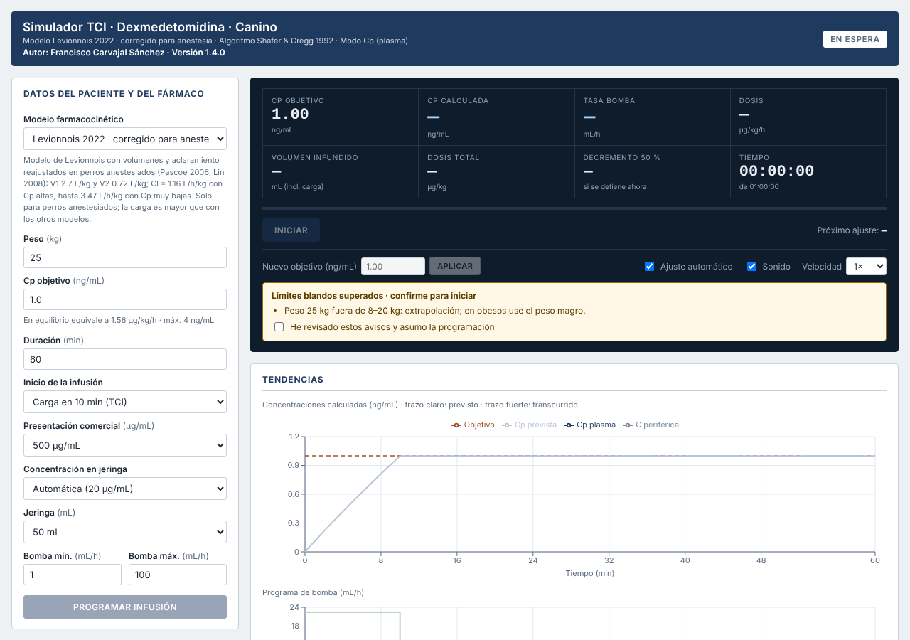
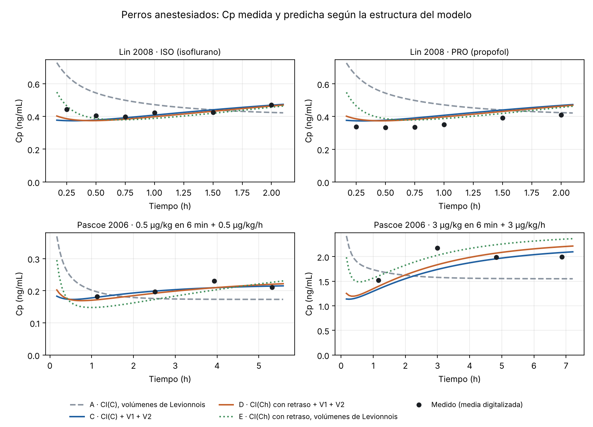

# Dossier técnico · Simulador TCI de dexmedetomidina en perros v1.4.0

<p class='byline'>Francisco Carvajal Sánchez · Universidad Privada Antenor Orrego, Trujillo, Perú · 27 de octubre de 2026</p>

## 1. Qué se pide al revisor

Pido una revisión técnica independiente del programa y de su documentación: si el simulador calcula lo que dice calcular, si la lógica de seguridad es sólida y si la verificación basta para usarlo en un estudio clínico (Fases 2 y 3). Este dossier resume el programa, los cambios de la versión 1.4.0 y las pruebas realizadas. El código, los datos y los scripts acompañan al documento.

La versión 1.4.0 cambia el modelo farmacocinético por defecto. El nuevo modelo responde a las observaciones de los farmacólogos de IRNASUS UCC-CONICET (reunión del 27/10/2026): ahora los volúmenes central y periférico se ajustan a la vez que el aclaramiento.

**Preguntas concretas**

1. **Motor numérico.** Con aclaramiento dependiente de la concentración, el motor integra con Runge-Kutta 4 (paso de 1 s) y resuelve la carga con el método de la secante. La Cp mostrada se integra por Euler con paso de 1 s y la tasa real de la bomba. ¿Son métodos y pasos adecuados? ¿Ve casos límite (pesos de 2–80 kg, concentraciones casi nulas, tasas en el mínimo de la bomba) mal cubiertos?
2. **Lógica de seguridad.**
    - Hay límites duros (bloquean) y blandos (piden confirmación).
    - La carga se alarga si supera 30 µg/kg/h.
    - Al reanudar tras una pausa, los límites se comparan con una línea base tomada al pausar.
    - ¿Hay secuencias de uso que permitan superar un límite duro o saltarse una confirmación?
3. **Verificación.** Hay pruebas de regresión, una implementación de referencia independiente, una prueba de estrés con invariantes y pruebas de interfaz en el navegador (apartado 6). ¿Qué falta para considerarla suficiente? Por ejemplo, pruebas unitarias formales, cobertura de código, revisión por terceros o un proceso tipo IEC 62304.
4. **Trazabilidad.** El CSV exportado guarda la tasa real de la bomba segundo a segundo, con el peso y la concentración sin redondear, y la Cp se puede recalcular de forma independiente. ¿Basta para documentar cada caso del estudio clínico?
5. **Implementación del modelo nuevo.** ¿Se aplica correctamente con volúmenes distintos de los publicados (carga, mantenimiento, descenso libre y tabla de parámetros)?
6. **Distribución.** El programa es una sola página HTML que funciona sin conexión y se identifica por su huella SHA-256. La aplicación de Windows no se ha actualizado a la v1.4.0. ¿Qué recomienda para distribuirlo de forma controlada (firma, control de versiones, bloqueo de la configuración)?
7. **Uso.** El simulador tiene un modo manual en el que un operador confirma cada cambio de tasa, además de alarmas sonoras y avisos. ¿Ve riesgos de uso que convenga resolver antes del estudio?

Le agradeceré que indique, en cada punto, si lo considera **bloqueante** (resolver antes del primer perro) o **mejora** (puede esperar).

## 2. Resumen

El simulador calcula la velocidad de una bomba de jeringa convencional para alcanzar y mantener una concentración plasmática objetivo (Cp) de dexmedetomidina en el perro. No controla bombas: indica al operador la tasa que debe programar y cuándo cambiarla. Es por ahora una herramienta educativa y de investigación, sin validación clínica.

| Elemento | Situación (v1.4.0, 27/10/2026) |
| --- | --- |
| Modelo base | Levionnois et al. 2022: bicompartimental, 8 Beagles despiertos, bolo de 10 µg/kg |
| Algoritmo TCI | Shafer y Gregg (1992), modo plasma, carga en 10 min, pasos de bomba de 0,1 mL/h |
| Modelo por defecto (nuevo) | «Corregido para anestesia»: V1 2,70 L/kg, V2 0,72 L/kg y aclaramiento dependiente de la Cp (Cl0 3,47 L/h/kg; C50 0,21 ng/mL) |
| Modelos para comparar | «Ampliado» de las v1.2–v1.3 (solo aclaramiento) y el publicado de Levionnois |
| Verificación de la v1.4.0 | Conforme. Modelos anteriores idénticos a la v1.3.0 (200/200); Cp del programa igual a la de una implementación independiente (298 casos; diferencia ≤ 0,1 % con Cp > 0,05 ng/mL); 4949 casos válidos de estrés sin fallos; 27 pruebas de hallazgos y 16 de interfaz superadas |
| Programa | `simulador_tci_dexmedetomidina.html`, una sola página sin conexión. SHA-256 `014e9370…f038a` |
| Fases 2 y 3 | Protocolo TCI-DEX-01 redactado (30 perros anestesiados con isoflurano, 18 con muestras). Se reescribirá tras la reunión con CONICET. No iniciado |



*Figura 1 · Simulador v1.4.0 con los valores por defecto (perro de 25 kg, 1 ng/mL, modelo corregido), antes de iniciar. El único aviso es el peso, fuera del rango de los Beagles del modelo.*

## 3. Cambios desde la versión 1.2.1

| Versión | Cambios |
| --- | --- |
| 1.2.2 | Los modelos se presentan como «Levionnois 2022 · original» y «ampliado para anestesia». Solo cambian textos. |
| 1.3.0 | Menos restricciones por debajo de 4 ng/mL; corrección de los defectos D-03 a D-06 y peritaje del código (detalle debajo). |
| 1.4.0 | Nuevo modelo por defecto, «corregido para anestesia», con V1, V2 y aclaramiento reajustados; se conserva el ampliado de la v1.3 para comparar. Objetivo inicial por defecto: 1 ng/mL. |

**Novedades de la v1.3.0**

- Subir el objetivo durante una carga es ahora un aviso blando, y la carga se recalcula desde la Cp actual.
- El objetivo se puede cambiar en pausa; se aplica al reanudar.
- Al reanudar se revisan los límites frente a lo confirmado al pausar.
- Defectos corregidos:
    - **D-03:** pausar en modo manual reescribía el historial.
    - **D-04:** se podía reanudar sin revisar límites.
    - **D-05:** se atribuía mal el límite entre la bomba y la dosis.
    - **D-06:** los avisos se comparaban por texto exacto.

**Cambios en el código de la v1.4.0**

- Nueva entrada en `PK_MODELS`, que pasa a ser el modelo por defecto.
- Notas de cada modelo en la interfaz.
- Objetivo inicial por defecto de 1 ng/mL. Con 2 ng/mL y el modelo nuevo, la carga es de 6 µg/kg y aparecen cinco avisos al abrir el programa.
- El motor no cambia. Ya admitía volúmenes cualesquiera y aclaramiento dependiente de la Cp; la regresión lo confirma (apartado 6).

## 4. Modelos farmacocinéticos

Los tres modelos comparten la estructura bicompartimental de Levionnois (Cl2 = 1,87 L/h/kg) y escalan todos los parámetros de forma lineal con el peso. Difieren en los volúmenes y en el aclaramiento:

| Modelo | V1 (L/kg) | V2 (L/kg) | Aclaramiento (L/h/kg) | Uso |
| --- | --- | --- | --- | --- |
| Corregido para anestesia (v1.4.0, por defecto) | 2,70 | 0,72 | Cl(C), con Cl0 3,47 y C50 0,21 | Perros anestesiados |
| Ampliado, solo aclaramiento (v1.2–v1.3) | 1,03 | 0,41 | Cl(C), con Cl0 3,15 y C50 0,92 | Comparación |
| Original (Levionnois 2022) | 1,03 | 0,41 | 1,16 constante | Comparación; perros despiertos |

**Ecuaciones.** Cantidades A1 y A2 en µg, Cp = A1/V1 en ng/mL y R = velocidad de infusión en µg/min:

```
dA1/dt = R(t) − (k10 + k12)·A1 + k21·A2        dA2/dt = k12·A1 − k21·A2
k10 = Cl(C)/V1    k12 = Cl2/V1    k21 = Cl2/V2
Cl(C) = Cl∞ + (Cl0 − Cl∞)·C50/(C50 + C),   Cl∞ = 1,16 L/h/kg (el publicado)
```

**Por qué cambia el modelo por defecto.** En la reunión del 27/10/2026, los farmacólogos de IRNASUS UCC-CONICET señalaron cuatro problemas:

- Fijar los volúmenes de Levionnois hace que el error de volumen se cargue sobre el aclaramiento.
- Las ecuaciones de aclaramiento solo valen cerca del estado estacionario; fuera de él lo sobrestiman.
- La fisiología no es constante durante la anestesia.
- Los datos son medias de grupo de Beagles jóvenes, con poca variabilidad de peso y mayoría de machos.

Por eso se reajustaron el aclaramiento y los dos volúmenes a la vez con los datos de perros anestesiados (`validacion_fase1/modelo_volumenes_aclaramiento.py`).

| Estructura (perros anestesiados, n = 20) | MDPE / MDAPE | AICc | Predice el estudio no usado: Lin / Pascoe |
| --- | --- | --- | --- |
| Ampliado v1.3 (volúmenes de Levionnois) | −8,8 % / 23,7 % | −47,0 | −32 % / +42 % |
| Aclaramiento constante + V1 + V2 | −3,8 % / 11,4 % | −62,5 | −18 % / +12 % |
| **Corregido: Cl(C) + V1 + V2** | **−0,3 % / 8,5 %** | **−80,2** | **−20 % / +17 %** |
| Cl(C) con retraso hemodinámico + V1 + V2 | +0,1 % / 9,1 % | −80,3 | −17 % / +4 % |



*Figura 2 · Perros anestesiados (Lin 2008 y Pascoe 2006): el modelo anterior (gris) predice que la Cp baja tras la carga. El corregido (azul) reproduce la subida de las primeras 2–3 h.*

**Lo que muestra el reajuste**

- **Volumen central:** en anestesia es unas 2,6 veces el de Levionnois (IC 95 % aproximado por perfil de verosimilitud: 2,2–3,0).
- **Volumen periférico:** no se puede determinar con estos datos (0,5–3,5 veces).
- **Aclaramiento:** la dependencia de la concentración se mantiene, porque el modelo con aclaramiento constante ajusta peor. Con 0,5 / 1 / 2 ng/mL el aclaramiento es 1,83 / 1,56 / 1,38 L/h/kg, dentro del flujo hepático del perro.
- **Descenso tras detener la infusión:** se reproduce mejor. La semivida es 0,47 h con el corregido, 0,36 h con el ampliado y 0,43 h la medida.
- **Estado estacionario:** calcular el aclaramiento como tasa/Cp antes del equilibrio lo sobrestima. Con el modelo corregido el error es del 70 % a las 2 h, y el equilibrio tarda más de 8 h.

**Consecuencias para la dosificación (perro anestesiado)**

| Objetivo | Carga en 10 min: ampliado → corregido | Mantenimiento en equilibrio: ampliado → corregido |
| --- | --- | --- |
| 0,5 ng/mL | 0,70 → 1,51 µg/kg | 1,25 → 0,92 µg/kg/h |
| 1 ng/mL | 1,38 → 2,99 µg/kg | 2,16 → 1,56 µg/kg/h |
| 2 ng/mL | 2,69 → 5,94 µg/kg | 3,64 → 2,76 µg/kg/h |

Con el modelo corregido la carga se duplica y el mantenimiento baja un 25–30 %. Esto concuerda con Pascoe 2006: una carga de 3 µg/kg seguida de 3 µg/kg/h dio unos 1,5 ng/mL a la hora y unos 2 ng/mL desde las 3 h. Por encima de unos 1,7 ng/mL, la carga supera el tope de 30 µg/kg/h y se alarga más allá de 10 min.

**Límites del modelo corregido**

- **Datos de calibración:** medias de grupo de dos estudios (20 puntos).
- **Volumen periférico:** sin determinar.
- **Variante con retraso:** el modelo con aclaramiento con retraso ajusta igual y no se puede distinguir del corregido con estos datos.
- **Solo vale en anestesia:** en Lin 2008, con la misma infusión, la Cp cae a la mitad cuando los perros despiertan.

## 5. Algoritmo TCI y lógica de la bomba

1. **Subida de objetivo.** Carga a velocidad constante durante 10 min, calculada para que la Cp llegue exactamente al objetivo al final (no se usa bolo rápido, para atenuar la respuesta hipertensiva).
    - Con el modelo lineal la solución es analítica.
    - Con aclaramiento dependiente de la Cp se usa Runge-Kutta 4 (paso de 1 s) con el método de la secante.
    - Si la carga supera 30 µg/kg/h o el máximo de la bomba, se alarga.
2. **Mantenimiento.** Con la Cp fija en el objetivo, la velocidad ideal es R(τ) = A1·(k10 + k12) − k21·A2(τ). Es exacta también con aclaramiento variable, porque con la Cp constante el aclaramiento no cambia.
3. **Bomba discreta.** Cada velocidad se redondea a 0,1 mL/h y se mantiene mientras la ideal quede dentro de una banda de ±5 %. Con aclaramiento variable la banda se estrecha según la sensibilidad d ln(C·Cl)/d ln C.
4. **Bajada de objetivo o pausa.** Bomba a 0 hasta que la Cp, en descenso libre, alcanza el objetivo.
5. **Cp mostrada.** Se integra por Euler con paso de 1 s y la velocidad que lleva realmente la bomba. En modo manual se usa la hora a la que el operador confirma cada cambio.
6. **Fin de la infusión.** La Cp se sigue calculando 120 min tras detenerla.

**Límites de seguridad** (los mismos con todos los modelos; anclados al equilibrio del modelo publicado, Cp = dosis horaria / 1,16 L/h/kg):

| Límite | Blando (pide confirmación) | Duro (bloquea) |
| --- | --- | --- |
| Cp objetivo | > 2,5 ng/mL | > 4 ng/mL |
| Dosis por carga | > 3 µg/kg | vía tasa máxima |
| Tasa instantánea | > 20 µg/kg/h | 30 µg/kg/h (la carga se alarga) |
| Dosis en 60 min | > 6 µg/kg | > 12 µg/kg |
| Subida de objetivo | > +1 ng/mL, o durante una carga | — |
| Duración | > 120 min | > 240 min |
| Peso | fuera de 8–20 kg | fuera de 2–80 kg |

**Pausa y reanudación (desde la v1.3.0).**

- Al pausar se guarda la línea base de avisos.
- Al reanudar, un límite duro nuevo o peor que esa línea base impide reanudar. Un aviso blando nuevo o peor (en más de un 2 %) pide un segundo clic.
- Los avisos son estructurados (nivel, código y valor) y no se comparan por texto.

## 6. Verificación

**Verificación de la v1.4.0** (`verificacion/v140/ejecutar_verificacion_v140.sh`):

| Prueba | Resultado |
| --- | --- |
| REG-03 · Los modelos anteriores dan el mismo programa, la misma Cp y los mismos avisos que la v1.3.0 (casos aleatorios con cambios de objetivo y pausas) | 200/200 idénticos |
| Reconstrucción independiente de la Cp desde el CSV de cada caso (`reconstruir_cp.py`; exponencial de matriz o Dormand-Prince 8 con tolerancia 10⁻¹⁰), con los tres modelos | 298/298 conformes. Diferencia máxima del 0,1 % con Cp > 0,05 ng/mL; las mayores (≤ 0,5 %) se dan con Cp casi nula, por el redondeo del CSV |
| TCI-C · Modelo corregido: Cp al final de la carga dentro de ±1 % y mantenimiento dentro de ±5,5 % (ampliados con la resolución de la bomba) | 400 cargas (244 alargadas por el tope de dosis) y 400 mantenimientos sin fallos; desviación máxima en mantenimiento 2,7 % |
| Peritaje · pruebas de hallazgos H-01 a H-09 con cada modelo | 27/27 (H-09 no aplica con el modelo publicado: su carga no llega al tope de dosis) |
| Peritaje · prueba de estrés: 4991 configuraciones y secuencias aleatorias con los tres modelos (4949 válidas), con invariantes | 0 fallos |
| Interfaz en Chromium: versión, selector con tres modelos, programación y carga con cada modelo, Cp tras la carga, CSV exportado, errores de JavaScript | 16/16 |

**Verificaciones anteriores que siguen vigentes**

- **v1.2.1 (Fase 0):**
    - 944 escenarios frente a una implementación de referencia escrita aparte; error numérico máximo del 0,06 %.
    - Regresión frente a la v1.2.0 (1844/1844) y la v1.1.1 (922/922).
    - 22 pruebas de interfaz en HTML y en la aplicación de Windows, y 9 de instalación.
- **v1.3.0 (peritaje):**
    - Tres revisiones del código.
    - Pruebas H-01 a H-09.
    - Prueba de estrés de 4991 casos.

**Lo que aún no está cubierto**

- La aplicación de Windows de la v1.4.0: no se ha recompilado.
- El arnés completo de la Fase 0 (escenarios, interfaz y .exe): se perdió con el reinicio del entorno de trabajo del 24/10 y se ha sustituido por las pruebas de esta tabla.
- Las pruebas son del mismo equipo que el programa, con ayuda de IA. Por eso se pide esta revisión.

## 7. Validación externa (Fase 1), en resumen

- **Datos:** 7 estudios publicados (93 medias de grupo; figuras de Lin 2008 y Pascoe 2006 digitalizadas).
- **Modelo publicado:** predice bien las concentraciones de 2–15 ng/mL, pero sobrestima las de uso clínico, sobre todo en perros anestesiados (MDPE −50 %).
- **Ampliado (v1.2–v1.3):** reduce ese sesgo a −11 % (MDAPE 23 %).
- **Corregido (v1.4.0):** lo reduce a −0,3 % (MDAPE 8,5 %) con los mismos datos.

El informe completo está en `informes/Informe_Fase1_validacion_externa_v4.pdf`, y el reajuste con volúmenes en `documentos/fase1_v5_volumenes_aclaramiento.md`.

## 8. Limitaciones conocidas

- **Datos agregados.** Todos los datos externos son medias de grupo, sin datos individuales. Una dependencia de la concentración ajustada sobre medias puede deberse en parte a mezclar perros distintos.
- **Población.** Beagles jóvenes de 8–20 kg con mayoría de machos. El simulador escala linealmente con el peso hasta 80 kg; el peso y el sexo deben evaluarse como covariables.
- **Fisiología variable.** El aclaramiento depende del gasto cardíaco y del flujo hepático, que cambian con la dosis, el tiempo, la anestesia y la temperatura. El modelo los resume en la Cp de cada instante.
- **Solo en anestesia.** El modelo corregido no sirve en perros despiertos.
- **Plasma, no sitio efecto.** No hay ke0 ni modelo farmacodinámico. Los revisores de CONICET proponen añadir un modelo PK/PD y un modelo poblacional nuevo con peso y sexo.
- **Premedicación IM.** Sus supuestos no están validados y el estudio no la usa.
- **Autoría.** El modelo, el análisis y el software son del mismo autor, que tiene un interés comercial en el simulador.

## 9. Archivos y cómo reproducir

Todo está en el repositorio del proyecto. Para probar el programa basta abrir `simulador/simulador_tci_dexmedetomidina.html` en Chrome, Edge o Firefox; funciona sin conexión.

| Archivo | Contenido |
| --- | --- |
| `simulador/tci_dexmedetomidina_perros.jsx` | Código del simulador (modelos y motor al principio del archivo) |
| `simulador/simulador_tci_dexmedetomidina.html` | Programa compilado, una sola página |
| `compilar/` | Compilación con dependencias fijadas (esbuild 0.28.2, React 18.3.1, Recharts 2.15.4). Es reproducible byte a byte |
| `verificacion/v140/` | Verificación de la v1.4.0 (`ejecutar_verificacion_v140.sh`) |
| `verificacion/peritaje/` | Prueba de estrés y pruebas de hallazgos |
| `verificacion/motor/reconstruir_cp.py` | Cp de cada modelo a partir del CSV de un caso (verificación y Fase 3) |
| `validacion_fase1/` | Datos publicados, calibraciones y reajuste con volúmenes |
| `documentos/` | Protocolo TCI-DEX-01, acta de la reunión con CONICET y este dossier |

**Comandos para reproducir**

- Compilar: `sh compilar/compilar_html.sh`.
- Verificar la v1.4.0: `sh verificacion/v140/ejecutar_verificacion_v140.sh` (≈ 10 min).
- Reajustar el modelo: `python3 validacion_fase1/modelo_volumenes_aclaramiento.py` (≈ 15 min).

**Huellas SHA-256 de la v1.4.0**

| Archivo | SHA-256 |
| --- | --- |
| `tci_dexmedetomidina_perros.jsx` | `da9205562c8c9946814d03cc56ac816da2332b00669dbac16cd4e271e71b3f13` |
| `simulador_tci_dexmedetomidina.html` | `014e937009013abc5bd123deb0a9c30baabee9116f2a410d98be805bd1bf038a` |

Respuesta deseada: un breve informe con su valoración de cada punto del apartado 1, indicando si es bloqueante o mejora.
